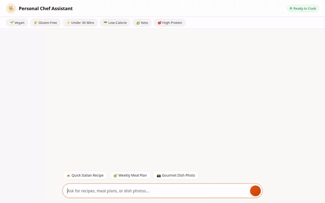

# Personal Chef & Recipe Assistant



An AI-powered **Personal Chef & Recipe Assistant** built with Google's Agent Development Kit (ADK), Vertex AI, and Google Cloud services. The assistant helps users plan meals, discover recipes, generate dish photography and cooking videos, search for nearby supermarkets, and remember dietary restrictions across sessions.

---

## 🌟 Implemented Features & Architecture

The capabilities below are fully implemented in code within `app/` and configured in `agents-cli-manifest.yaml`:

- **🧠 Cross-Session Long-Term Memory (Vertex AI Memory Bank)**:
  - Integrates `VertexAiMemoryBankService`, `PreloadMemoryTool`, and automatic callbacks (`add_session_to_memory`) to track and enforce user allergies, intolerances, and preferences across sessions.

- **🗄️ Firestore Recipe & Meal Plan Database (`app/firestore_db.py`)**:
  - `search_recipes`: Searches stored recipes by diet type, prep time, and cuisine.
  - `get_recipe_by_id`: Fetches complete recipe details.
  - `add_recipe`: Persists new recipes directly to Google Cloud Firestore.
  - `save_meal_plan` & `get_meal_plan`: Saves and retrieves weekly custom meal plans.

- **📸 Multimodal Dish Photography (`app/image_tool.py`)**:
  - `generate_dish_image`: Generates dish imagery using `gemini-3.1-flash-lite-image` via `google.genai`, saves artifacts via `tool_context.save_artifact`, and uploads image bytes directly to a public Google Cloud Storage bucket.

- **🎥 Cooking Technique Video Generation (`app/video_tool.py`)**:
  - `generate_cooking_video`: Generates short cooking technique and dish preparation videos using Google's `gemini-omni-flash-preview` model via the Vertex AI Interactions API. Uploads MP4 video bytes directly to Google Cloud Storage and registers artifacts for the Playground panel.

- **🗺️ Supermarket & Geocoding Tools (`app/maps_tools.py`)**:
  - `geocode_address` & `find_nearby_places`: Integrates with Google Maps Places API to locate nearby grocery stores and ingredients suppliers based on location.

- **🌐 External Recipe Integration (`app/external_api.py`)**:
  - `fetch_external_recipes`: Fetches external culinary ideas via public web endpoints.

- **🎨 Agent-to-User Interface (A2UI) (`app/a2ui_utils.py`)**:
  - Formats responses using `A2uiSchemaManager` and `BasicCatalog` to render structured UI cards directly in supported UIs.

- **💻 Python Sandbox Code Execution (`app/agent.py`)**:
  - Uses `AgentEngineSandboxCodeExecutor` for calculating ingredient scaling, recipe yields, and nutritional totals.

---

## 📋 Features Not Implemented (Planned)

- **🎙️ Real-Time Voice Step-by-Step Cooking Guidance**: *(Planned, not yet implemented)*

---

## 📁 Project Structure

```
personal-chef-agent/
├── app/                      # Agent code & tool implementations
│   ├── agent.py              # Root agent definition & prompt configuration
│   ├── a2ui_utils.py         # A2UI callback & schema handlers
│   ├── external_api.py       # External recipe API tool
│   ├── firestore_db.py       # Firestore database CRUD tools
│   ├── image_tool.py         # Gemini image generation & GCS upload tool
│   ├── maps_tools.py         # Google Maps geocoding & places tools
│   └── video_tool.py         # Gemini Omni video generation tool
├── frontend/                 # FastAPI proxy & custom chat UI
│   ├── main.py               # FastAPI proxy server
│   └── static/               # Chat UI templates & styles
├── demo.gif                  # Looping demo recording
├── pyproject.toml            # Python dependencies and project metadata
└── agents-cli-manifest.yaml  # Agent deployment manifest
```

---

## 🚀 Local Setup & Development

### Prerequisites
- Python 3.11+
- `uv` package manager (`uvx google-agents-cli setup`)

### 1. Install Dependencies
```bash
agents-cli install
```

### 2. Run ADK Development Playground
```bash
agents-cli playground
```

### 3. Run Custom FastAPI Frontend & Proxy
```bash
cd frontend
pip install -r requirements.txt
export AGENT_ENGINE_RESOURCE_NAME="<YOUR_AGENT_ENGINE_RESOURCE_NAME>"
export AGENT_DIRECTORY="app"
python main.py
```

---

## ☁️ Deployment

Deploy the agent to Vertex AI Agent Runtime:
```bash
agents-cli deploy --update-env-vars GOOGLE_MAPS_API_KEY=<YOUR_MAPS_KEY> --no-confirm-project
```
